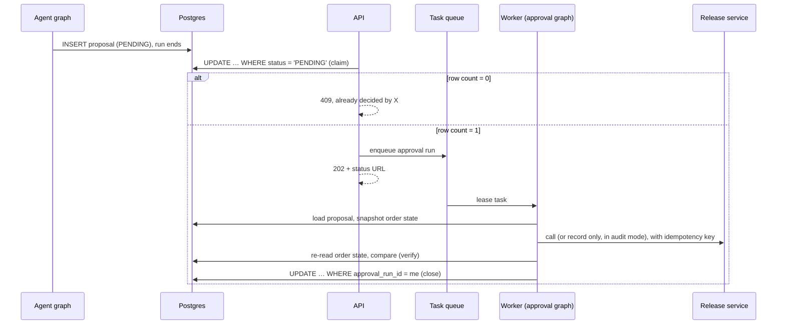

# agent-approval-patterns

Durable human approvals, audit mode and state-based verification for agent actions. A small reference implementation on synthetic data, built with LangGraph, FastAPI and Postgres.

**Scope:** this repo demonstrates patterns and is not a framework. It is the companion code for the blog series *Agents that don't get to decide*.

## The problem

An agent that repairs things in production needs three properties before anyone lets it act:

1. **A person approves anything risky, and the approval happens exactly once.** This must hold when two reviewers click at the same time, when a client retries, and when the approval arrives hours later, after a deploy.
2. **The agent can run without acting.** It records what it *would* do until you trust it. This is audit mode, and it is on by default.
3. **"It worked" means the state changed.** A `200 OK` from the downstream service is not enough.

The obvious LangGraph approach is to pause the graph with `interrupt_before` and resume it when the person decides. That keeps a paused run alive for as long as the person takes. This repo does the opposite: **the escalation is a row in a table, not a paused run.**

## The design



| Piece | File | What it guarantees |
|---|---|---|
| Proposal store | `proposals.py` | A proposal's options must be registered actions. One atomic conditional `UPDATE` per transition. Exactly one claim wins. A stale claim (15 min) can be taken over. Only the claim holder can close. The reviewer's action must be one the proposal offered. |
| Approval graph | `approval_graph.py` | `load → execute → verify → close`, seeded only from the row. It does nothing if the run doesn't hold the claim or the proposal is already closed. |
| Audit mode | `audit_mode.py`, `actions.py` | Per-agent override, then the global default, which is **on**. `run_action` defaults to `dry_run=True`, so a caller that forgets to decide records instead of acting. A dry run logs the exact request it would have sent. Repeat scans record one dry run per order per day. |
| Audit report | `audit_report.py` | `GET /audit-report` keeps three kinds of evidence apart: what agents *would* have done, what real calls achieved (verified), and how often reviewers picked the agent's first-choice fix. Dry runs never count toward a success rate. |
| Actions | `actions.py` | Each action declares the state it should produce. Unimplemented actions report `not_implemented`, never success. |
| Verifier | `verifier.py` | Re-reads the order: `verified`, `failed`, `unconfirmed` (nothing changed) or `not_checkable`. |
| Task queue | `tasks.py`, `worker.py` | Postgres `FOR UPDATE SKIP LOCKED`, with a lease (5 min) that is deliberately shorter than the claim timeout (15 min). |
| Agent | `agent.py` | Deterministic rules decide; there is no LLM in the control loop. It retries while under the limit and escalates after. It doesn't re-escalate an order that already has an open proposal. |
| Mock downstream | `release_service.py` | Writes a ledger of every call so tests can count real effects. Supports idempotency keys and fault injection (`ERROR`, `SILENT`). |

More detail: [docs/architecture.md](docs/architecture.md).

## Run it

You need Docker (for Postgres) and [uv](https://docs.astral.sh/uv/).

```bash
docker compose up -d db
uv sync
uv run agent-approval-patterns-seed            # schema + 4 synthetic orders
```

Start the API, with audit mode **off** so actions really run:

```bash
AUDIT_MODE=false uv run uvicorn agent_approval_patterns.api:default_app --factory --port 8000
```

## Walkthrough

**1. Let the agent scan.** ORD-1001 is under the retry limit, so the agent retries it and verifies the result. ORD-1002 and ORD-1003 are over the limit, so the agent escalates them as proposals 1 and 2.

```bash
curl -s -X POST localhost:8000/scan
curl -s localhost:8000/proposals          # two PENDING proposals
```

**2. Approve, then approve again.** The first approval gets `202`. The second gets `409` and the name of who decided first.

```bash
curl -s -X POST localhost:8000/proposals/1/approve \
  -H 'content-type: application/json' -d '{"user":"alice","action":"retry_release"}'
curl -s -X POST localhost:8000/proposals/1/approve \
  -H 'content-type: application/json' -d '{"user":"bob","action":"place_on_hold"}'
curl -s -X POST localhost:8000/proposals/2/approve \
  -H 'content-type: application/json' -d '{"user":"alice","action":"retry_release"}'
```

**3. Run the worker, then poll.**

```bash
AUDIT_MODE=false uv run agent-approval-patterns-worker --drain
curl -s localhost:8000/proposals/1   # COMPLETED, verification: verified
curl -s localhost:8000/proposals/2   # FAILED: the release service rejected ORD-1003
```

**4. Try audit mode.** Re-seed, restart the API without `AUDIT_MODE=false`, and repeat, scanning twice. The scan and the approvals record `dry_run`, proposals close as `AUDITED`, and `release_calls` stays empty. Then look at the evidence:

```bash
curl -s localhost:8000/audit-report
```

You'll see three would-be runs on three orders (the second scan didn't double-count ORD-1001), no real outcomes, and reviewer agreement of 2 out of 2.

## Tests

The tests run against a real Postgres. There is no in-memory fake, because the point is how the database behaves under contention.

```bash
uv run pytest -v
```

| Test | Shows |
|---|---|
| `test_concurrent_claims_exactly_one_winner` | 20 approvers on 20 connections, released together by a barrier: exactly one wins |
| `test_stale_claim_can_be_taken_over` / `test_fresh_claim_cannot_be_taken_over` | The 15-minute takeover boundary |
| `test_crash_after_call_then_stale_takeover` | A worker dies after the downstream call. With an idempotency key there is 1 effect; without one, 2. **The claim guarantees one approval, not one call.** |
| `test_worker_retries_a_task_after_a_crash` | The queue retries the task with the same run id, and the key deduplicates the call |
| `test_ok_response_without_effect_is_unconfirmed_not_completed` | The service returns OK and changes nothing, so the proposal is `UNCONFIRMED`, not `COMPLETED` |
| `test_unimplemented_action_is_reported_not_faked` | `NOT_EXECUTED`, verification skipped |
| `test_queue_failure_releases_the_claim` | If the task can't be queued, the proposal goes back to `PENDING` |
| `test_agent_in_audit_mode_logs_but_calls_nothing` | `dry_run` in the action log, zero downstream calls |
| `test_caller_that_does_not_decide_gets_a_dry_run` | Calling `run_action` without `dry_run` sends nothing |
| `test_repeated_scans_record_one_dry_run_per_order_per_day` | Three scans, one would-be run |
| `test_dry_runs_never_count_toward_success_rate` | Three "would succeed" dry runs and one real failure give a success rate of 0, not 0.75 |
| `test_agreement_is_measurable_in_audit_mode` | Reviewer agreement with the agent's first choice, while nothing real has run |
| `test_no_llm_in_the_loop.py` | Text a model might write ("Please retry the release…") can't be an action, a proposal option or an approval |

## Deliberately out of scope

- Authentication and authorization. `user` is taken from the request body.
- A UI. Use curl or the FastAPI docs at `/docs`.
- LLMs. The agent is rule-based on purpose. An LLM could draft the reason text, but it never chooses the action.
- Resuming a graph from a checkpoint mid-run, rate limits and circuit breakers. These are planned for later posts in the series.
- Production hardening: connection pooling, migrations, metrics.

## The series

Each post links to a tag, so the code you read matches the post.

| Post | Tag | Status |
|---|---|---|
| The pause nobody resumed: human-in-the-loop approvals people can rely on | `a1-approvals` | Draft |
| Audit mode: shipping an agent that isn't allowed to act yet | `a4-audit-mode` | Draft |
| A 200 OK is not a fix: verifying agent actions | `a5-verification` | Planned (code is already here) |
| Why I replaced an agent with three function calls | `a6-no-llm-in-the-loop` | Draft |
| Background tasks vs a real queue | `a3-queue-and-resume` | Planned (needs checkpoint resume) |
| The guardrails that never fired | `a2-guardrails` | Planned (needs rate limits and circuit breaker) |

## License

MIT
