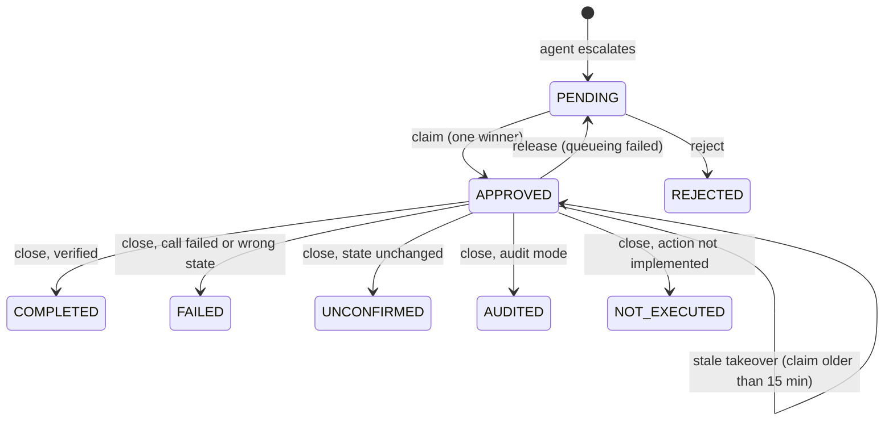
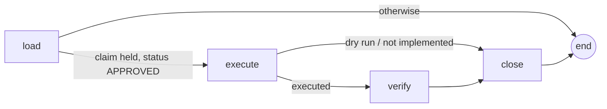

# Architecture

## Proposal lifecycle

Every arrow is one SQL statement whose `WHERE` clause holds the precondition. Each function in `proposals.py` returns whether its row count was 1, and callers branch on that. Nothing reads a row, decides, and then writes it back.

## Approval graph

## Timeouts, and why they differ

| Setting | Default | Meaning |
|---|---|---|
| `CLAIM_STALE_MINUTES` | 15 | After this, another approval can take over a claim |
| `TASK_LEASE_MINUTES` | 5 | After this, another worker can retry a running task |

`Settings` refuses a lease that is as long as the claim timeout or longer. If the two were equal, a stuck task's retry and a reviewer's re-approval could become eligible at the same moment, and both would start an approval run. A retry reuses the original run id, so it either finishes the original run's work or finds the claim gone and does nothing.

## Idempotency

The claim makes the **approval** happen once. It can't make the **downstream call** happen once: a worker can send the call and die before closing. The approval run sends `proposal-<id>` as an idempotency key, and the mock service ignores a key it has already applied. `test_crash_after_call_then_stale_takeover` runs the crash both with and without the key and counts the effects.

If your downstream service doesn't support idempotency keys, the fallback is to record "call sent" before sending. A takeover then checks the state before calling again.
